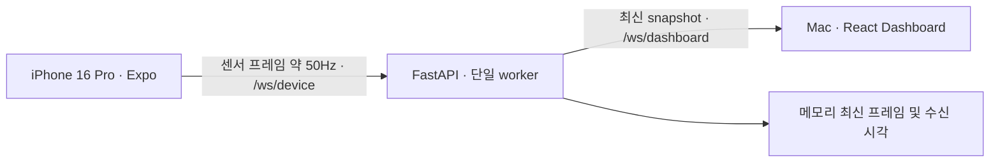
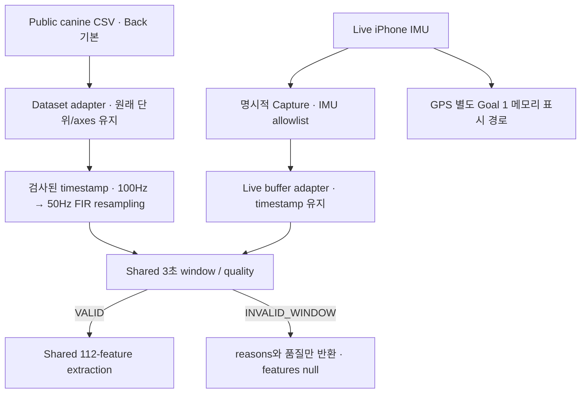

# 현재 아키텍처



## 센서 장치

`expo-sensors` Accelerometer/Gyroscope에서 `isAvailableAsync`, `requestPermissionsAsync`를 확인하고 `setUpdateInterval(20)`으로 구독한다. 값이 처음 도착하기 전에는 `waiting`/`null`이다. iOS 동작 권한은 OS가 공유할 수 있으므로 별도 대화상자가 매번 뜨는 것은 아니다.

`expo-location` foreground 권한 및 위치 서비스 활성화를 확인한 후 `watchPositionAsync`를 사용한다. High accuracy, distanceInterval 0을 요청한다. timeInterval 1000은 Android용 옵션이며 iOS에서 정확한 1Hz를 보장하지 않는다. 위치 watcher 초기화/최초 fix를 기다리느라 WebSocket을 막지 않는다.

모바일은 최신값을 참조에 보관하고 20ms를 요청한 양쪽 센서의 새 reading 쌍이 준비된 callback에서 한 프레임을 전송한다(Goal 2 보완). 가속도 센서가 없거나 지연되면 자이로 콜백을 사용한다. 동작 콜백이 없을 때는 100ms 상태 heartbeat로 권한/결측/지연 상태를 전달한다. iOS에서 20ms JS interval을 사용했을 때 약 30Hz로 전송된 실측 문제를 피하도록 native 센서 콜백이 전송을 구동한다. UI는 100ms마다 갱신한다. 프레임마다 과거 샘플의 나이를 검사해 동작 센서 1초, GPS 15초 초과 시 `null`/`stale`로 투영한다. 샘플 도착 시각은 Unix ms이다. 가속도/자이로 timestamp는 JS listener 수신 시각이며 하드웨어의 동기화된 샘플 시각이 아니다. GPS timestamp는 위치 API의 fix 시각이며, iOS의 소수점 밀리초를 Math.trunc로 정수 밀리초로 정규화한다. 현재 시각으로 대체하지 않는다.

Start 실행 중 Stop/백그라운드/언마운트/연결 실패가 발생하면 generation token으로 오래된 async 작업을 무효화하고 나중에 완료되는 위치 구독까지 제거한다. 자동 재시작은 하지 않는다. 네트워크 전송 버퍼가 64KiB를 초과하면 수집을 종료하고 재시작 안내를 표시한다. 장치 ID는 설치별 UUID로 AsyncStorage에 저장한다. 모바일에서 센서/GPS 데이터를 영구 저장하지 않는다. 서버의 명시적 IMU capture는 아래 Goal 2 절을 따른다.

## 메시지 계약

TypeScript/Zod: `packages/protocol/src/index.ts`. Python/Pydantic: `services/api/guidesense_api/models.py`.

```json
{
  "type": "sensor_frame",
  "deviceId": "example-device",
  "timestamp": 1791380000000,
  "accelerometer": {
    "x": 0.01,
    "y": 0.02,
    "z": -0.98,
    "timestamp": 1791380000000
  },
  "gyroscope": { "x": 0.1, "y": 0.2, "z": 0.3, "timestamp": 1791380000000 },
  "location": null,
  "sensorStatus": {
    "accelerometer": "ready",
    "gyroscope": "ready",
    "location": "denied"
  }
}
```

위 예시는 **문서용 합성값**이며 앱의 초기값으로 사용하지 않는다. 모든 timestamp는 양의 정수 Unix epoch milliseconds. motion 단위는 g(중력 포함)/rad·s⁻¹. location이 존재하면 `latitude`, `longitude`, `accuracy`, `timestamp`가 필수이며 accuracy만 `null` 허용한다. 위도 ±90, 경도 ±180, 정확도 ≥0. NaN/Infinity/문자열 숫자/추가 필드는 거부한다.

상태: `waiting | ready | denied | unavailable | error | stale | stopped`. 각 센서의 상태가 ready일 때만 값이 존재해야 한다. 그렇지 않으면 반드시 null. 센서별 timestamp를 추가하여 늦은 GPS와 빠른 IMU 데이터를 구별한다.

API는 dashboard에 다음 envelope를 보낸다:

```text
type: "snapshot"
deviceId: string | null
status: "connected" | "disconnected"
lastSensorTimestamp: integer | null       # iPhone frame.timestamp
lastReceivedAt: integer | null            # Mac이 실제 수신한 wall-clock ms
timeoutMs: integer                       # 기본 3000
frame: SensorFrame | null                 # 마지막 유효 프레임; 연결 종료 후 이력 의미
```

## Backend와 연결 상태

- `/ws/device` 한 연결을 소유자로 지정한다. 두 번째 연결은 1008로 거부한다. 한 세션 중 deviceId 변경도 거부한다.
- JSON text 16KiB 이하, 엄격한 Pydantic 검증 후에만 프레임/수신 시각/카운터를 갱신한다. 잘못된 데이터는 연결 종료, 수신 시각은 갱신하지 않는다.
- 연결 상태는 **서버 monotonic clock의 마지막 유효 프레임 수신 후 경과시간**으로 판단한다. iPhone 시계가 다르거나 미래 timestamp여도 timeout 판정에 영향이 없다.
- Socket이 열렸다는 이유로 CONNECTED로 표시하지 않는다. 3초 이내 유효 프레임 수신 여부가 기준이다. 모든 센서가 null이어도 프레임이 수신되면 device는 connected, 센서 상태는 각각 비정상/미수신일 수 있다.
- Stop으로 socket이 닫혀도 freshness는 마지막 수신 기준으로 만료한다. 250ms heartbeat가 상태 변화를 발행한다. Dashboard 최초 연결 시 현재 snapshot을 즉시 보낸다.
- dashboard마다 길이 1인 큐에 최신 snapshot만 유지한다. 느린 소비자의 오래된 큐 항목은 버린다. 전송 timeout 2초 후 연결을 정리한다. 소비자 receive loop도 유지하여 idle 연결 종료를 감지한다.
- `/health`는 수신 카운트/상태/시각만 제공하며 좌표를 노출하지 않는다.
- 메모리 단일 프로세스 구조이며 DB/멀티 worker/pub-sub는 없다. 기본 relay의 이력은 없고 명시적 capture만 별도 파일에 저장한다.

## Dashboard

서버 transport와 device freshness를 별도로 관리한다. Zod 검증을 통과한 최신 snapshot을 10Hz로 렌더링한다. 연결 끊김 혹은 device timeout에서 이전 수치는 숨기고 마지막 시각만 남긴다. 서버 heartbeat도 4초 넘게 없으면 transport를 끊고 재연결한다. 재연결 backoff는 1, 2, 4, 8, 최대 10초. 디바이스 상태만 접근성 live region으로 알리고 센서 수치 전체를 계속 읽히지 않는다.

## 의도적인 제한

현재 하나의 기기, 신뢰하는 로컬 네트워크, 앱 foreground만 지원한다. GPS 수신률, iOS 스케줄링, Expo Go/iOS 27 실기기 호환성은 실제 환경에서 검증해야 한다. 인증/TLS/업로드/실시간 AI/지도/알람/브로치 출력은 없다. Goal 3 오프라인 행동 모델은 아래 별도 경로다. Expo Go 자체의 권한 manifest와 자체 development build의 manifest는 다르다.

## 참조

- [Expo Accelerometer SDK 57](https://docs.expo.dev/versions/v57.0.0/sdk/accelerometer/)
- [Expo Gyroscope SDK 57](https://docs.expo.dev/versions/v57.0.0/sdk/gyroscope/)
- [Expo Location SDK 57](https://docs.expo.dev/versions/v57.0.0/sdk/location/)
- [Expo Go SDK 호환성](https://docs.expo.dev/troubleshooting/expo-go-version-mismatch/)

## Goal 2: 공통 IMU 데이터 계층



코드: `ml/gait/guidesense_gait/`. adapter는 이름/시간 단위/출처만 맞추고 `pipeline.py`의 동일 window/feature 함수를 호출한다. 데이터셋의 DogID/TestNum 경계는 넘지 않으며 Walking 비교는 원문 annotation이 연속된 구간만 선택한다. label을 feature에 섞지 않는다.

### 시간과 품질 정책

- 기본 half-open `[start, start+3)` 초; 다음 경계의 sample은 다음 window에 속한다. 끝의 incomplete window도 INVALID_WINDOW로 반환한다.
- 50Hz nominal 150개. 실측 `(n-1)/(last-first)`는 45–55Hz, 최소 135개, 시작/끝 coverage 오차 각각 40ms 이하를 요구한다.
- 최대 sample 간격 35ms. 약 40ms 공백(50Hz에서 한 sample 누락)은 INVALID. 추정 누락 수는 관측 dt 기반 진단이며 실제 hardware 누락 확정값은 아니다.
- iPhone 양쪽 sensor timestamp의 비유한 값, 중복/역행, 35ms 초과 gap, 40ms 초과 frame/sensor skew도 INVALID. 센서 누락은 NaN으로 표현하고 feature에서 거부한다.
- 데이터셋 sampling은 median dt에서 측정한다. 1.5 source periods 초과 공백은 interpolation 전에 거부한다. timestamp 기반으로 source grid를 만들고 SciPy `resample_poly`의 Kaiser β=5 FIR를 적용해 50Hz로 낮춘다. 100→50은 up=1/down=2, 41 taps, line padding이다. 단순 row skipping은 aliasing을 일으킬 수 있어 사용하지 않는다.
- FIR는 offline 비인과 필터다. 비교 window는 annotation 구간 가장자리에서 최소 0.2초 context를 확보하며 기본 시작은 0.5초 뒤다. 원본 배열/CSV는 바꾸지 않는다. live에는 resampling/FIR를 강제하지 않는다.
- 중력 제거/high-pass 및 주파수 특징은 이번 범위에서 미적용.

### 공통 feature schema v1

채널 순서: `accel_x, accel_y, accel_z, gyro_x, gyro_y, gyro_z, accel_magnitude, gyro_magnitude`.
각 채널의 순서: `mean, std, variance, min, max, range, rms, median, p05, p25, p75, p95, energy, mean_square`.
**8×14=112**개. 이름은 `<channel>__<stat>`; `FEATURE_NAMES`가 고정 순서를 정의한다.

std/variance는 population(ddof=0), percentile은 NumPy 기본 linear 방식, energy는 `sum(x²)`, mean_square는 `mean(x²)`이다. energy는 sample count에 의존하므로 49Hz/50Hz 비교 시 mean_square도 함께 본다. energy는 물리적 joule이 아니다. magnitude는 각 3축 제곱합의 제곱근. UNKNOWN 단위도 metadata로 보존하고 임의 변환하지 않는다. NaN/Inf/overflow는 0으로 대체하지 않는다.

### Capture lifecycle

`POST /api/capture/start` JSON `{ "context": "human_held_phone" }`, `POST /api/capture/stop`, `GET /api/capture/status`.
단일 active session, 중복 Start/Stop은 409. IMU allowlist를 검증된 frame에서 별도 bounded queue(4096)에 투영하고 writer thread가 JSONL을 기록한다. 저장 실패/overflow는 상태에 표시하며 relay 전송은 계속한다. Stop은 입력을 분리한 뒤 writer drain과 metadata 원자적 저장을 기다린다. worker 하나만 지원한다. 빈 캡처는 저장될 수 있으나 분석 adapter는 거부한다.

새로운 저장 경로만 `data/captures/`; GPS와 기기 ID는 쓰기 큐에도 들어가지 않는다. 기존 snapshot schema, GPS 표시, 서버 freshness 및 dashboard 구독 방식은 유지한다. 모바일 callback pairing 보완은 [compatibility](sensor-compatibility.md)에 기록했다. 분류/질병 판단을 하는 endpoint나 UI는 없다.

## Goal 3: 오프라인 canine classifier와 recorded replay

`activity_data.py`가 원본을 chunk/session 단위로 처리하고 기존 공통 preprocessing/112 features를 호출한다. `activity_train.py`는 고정 DogID 분할 → Train fit → Validation 선택 → 저장 모델의 단 한 번 Test 평가를 제공한다. `activity_model.py`는 엄격한 모델/입력 계약과 SUPPORTED / UNVALIDATED / INVALID를 구분한다. `activity_replay.py`는 실제 원본 구간과 50Hz 파생 신호, 실제 annotation, 3초별 예측을 별도 필드로 export한다.

라이브 FastAPI 이벤트 루프에서 모델을 실행하지 않는다. API·mobile·Dashboard 경로는 유지되며 Goal 4는 [Replay 계약](goal3-replay-contract.md)을 통해 별도의 DATASET REPLAY 모드를 연결할 수 있다. 모델은 실제 public 데이터에만 지원되며 사람이 든 iPhone 또는 실제 안내견으로의 물리적 전이는 검증되지 않았다. [모델 설계](goal3-model-design.md), [실험 결과](goal3-training-results.md).

## Goal 4 확장

`GET /api/replays`와 `WS /ws/replay`를 추가했다. 각 replay socket은 독립 `ReplaySession`을 소유하며 source=`canine_dataset_replay`로 전송한다. 기존 live hub는 source=`iphone_live`를 추가하고 독립 수신/timeout을 유지한다. Dashboard는 기존 live hook와 새 replay hook를 분리한다. 모델 loader와 공통 window/feature 코드는 기존 ml/gait를 재사용하고 모델 실행은 worker thread에서 수행한다. 자세한 상태/추론 계약은 [Goal 4 integration](goal4-replay-integration.md)을 따른다.
